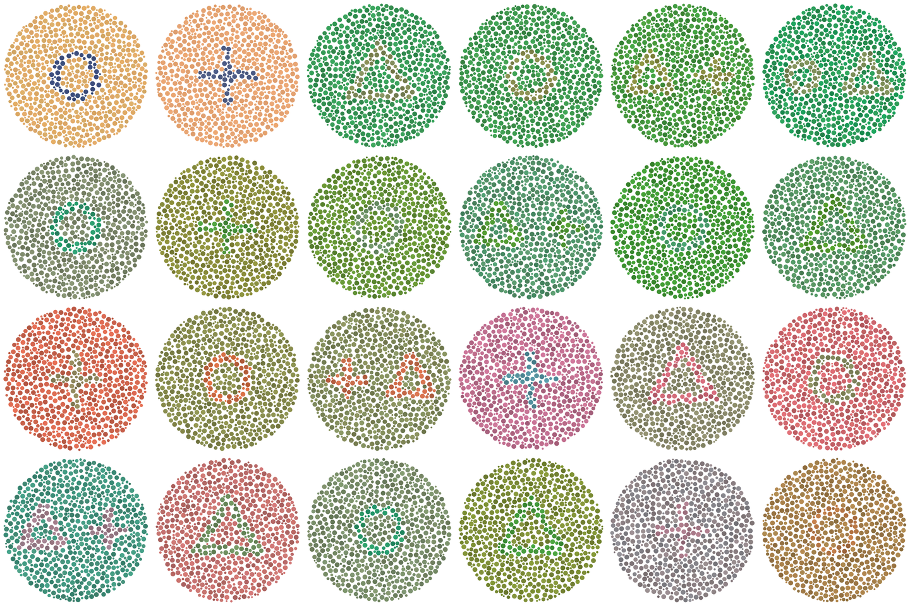

# VisionMate AI HRR-style Plate Set (24 plates)

**What it is:** 24 original, synthetic pseudoisochromatic plates (dot mosaics hiding a circle, cross or triangle),
*inspired by* the Hardy-Rand-Rittler (HRR) test. **It is not the HRR test and does not contain any HRR plate.**
Purpose: indicative colour-vision screening inside the VisionMate AI Android app. Not a medical diagnosis.
Not clinically validated.

## Contents and size
| Item | Value |
|---|---|
| Plates | 24 (`plate_01.png` ... `plate_24.png`) |
| Image format / size | PNG, 800 x 800 px, white background, circular plate (radius 382 px) |
| Dots per plate | about 680 - 710 (mean 692), radius 4.2 - 12.5 px |
| File size | about 390 - 460 KB per plate, about 10.7 MB for all 24 |
| Symbols | circle (10 plates), triangle (10), cross (9); 1 or 2 symbols per plate |
| Metadata | `plates.json`: answer key, group, number of dots, colour-verification numbers per plate |
| Generator | `generate_hrr_style_plates.py` (Python, numpy + Pillow, fixed random seed 2026, fully reproducible) |

## Plate groups
| Plates | Group | Purpose |
|---|---|---|
| 1-2 | demonstration | visible to everybody (checks the user understands the task) |
| 3-8 | red_green_screening (6) | hidden for protan and deutan |
| 9-12 | tritan_screening (4) | hidden for tritan |
| 13-16 | protan_type (4) | hidden for protan, still visible to deutan (type separation) |
| 17-20 | deutan_type (4) | hidden for deutan, still visible to protan (type separation) |
| 21-24 | severity_ladder (4) | red-green, normal-vision contrast falls 29 -> 26 -> 18 -> 13 (harder each plate) |

## How it was made 
1. **Colour space:** colours are chosen in CIELAB (D65), converted to linear sRGB.
2. **Colour-vision simulation:** Machado, Oliveira and Fernandes (2009) matrices for protan, deutan and tritan
   (severity 1.0; intermediate severities by linear interpolation with the identity matrix).
   The protan and deutan matrices were cross-checked against the `colorspacious` library (difference 0.0) and
   the tritan matrix against `DaltonLens` (max difference 0.004, 8-bit rounding).
3. **Confusion pairs:** for each plate a random search (300,000 candidate pairs, fixed seed) finds a figure colour
   and a ground colour whose a*b* difference is <= 3.5 after simulation of the deficiency to be hidden, > 14 for
   the deficiencies that must still see it, and close to a target value (e.g. 32 for screening) for normal vision.
4. **Dot mosaic:** random sequential packing of non-overlapping circles inside a disc; each dot inside the symbol
   mask gets a figure colour, every other dot a ground colour (3 slightly jittered colours each).
5. **Brightness randomisation:** each dot's linear RGB is scaled by a random factor (0.62 - 1.15), so the symbol
   cannot be found by brightness alone (chromaticity is unchanged because the simulation is linear).
6. **Verification:** the mean figure/ground colour difference for normal, protan, deutan, tritan and 50 %-severity
   protan/deutan is stored in `plates.json` for every plate.
7. **Symbols:** circle (ring), cross (plus) and triangle (outline), drawn as masks; 1 large or 2 small per plate.

## Limitations
* Not the real HRR plates, not clinically validated, indicative screening only.
* Simulation models are approximations; real eyes, screens and room lighting differ (screen brightness/colour
  calibration is not controlled).
* Separating protan from deutan is weaker than detecting red-green deficiency itself.
* Plate 24 is deliberately very hard; some normal observers may miss it.
* Not tested with real participants yet (suggested future work: small user study with Ishihara/HRR-screened volunteers).

## References for the methods
* G. M. Machado, M. M. Oliveira, L. A. F. Fernandes, "A physiologically-based model for simulation of color vision
  deficiency," IEEE TVCG 15(6), 2009.
* CIE, CIELAB colour space (CIE 15:2004); G. Sharma et al., CIEDE2000 (used in the app, not in plate generation).
* Hardy, Rand, Rittler (1954), H-R-R pseudoisochromatic plates (the test this set is *inspired by*).

## Licence
MIT (see `LICENSE`). The plates and the script are original work of the project team.
